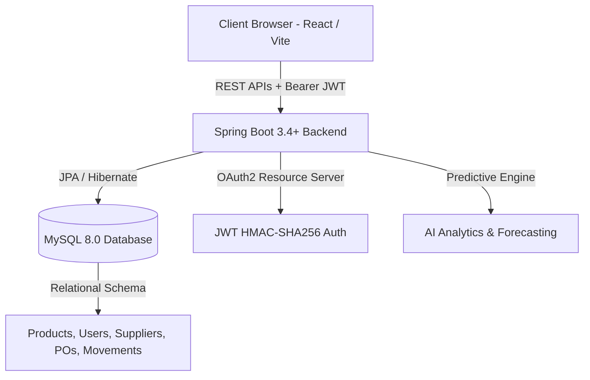

# 📦 StockPilot AI - Next-Gen Autonomous Inventory Decision Engine

[](https://spring.io/projects/spring-boot)
[](https://reactjs.org/)
[](https://vitejs.dev/)
[](https://www.mysql.com/)
[](https://jwt.io/)
[](https://www.chartjs.org/)
[](LICENSE)

**StockPilot AI** is an intelligent enterprise inventory management and supply chain optimization platform. Powered by **Spring Boot**, **MySQL**, and **React**, it unites real-time SKU ledger tracking, dynamic safety stock calculations, AI-assisted demand forecasting, automated purchase order lifecycles, and role-based operator portals.

---

## 🌟 Key Highlights & Features

- **🎬 Cinematic Splash Intro:** Airtribe-style brand reveal with smooth particle animations.
- **☁️ Josh W. Comeau Cloud Search:** Scalloped pure-white cloud search modal triggered instantly by keyboard shortcut (`/`) or search icon.
- **🏢 3D Warehouse Hero & Smooth Motion:** Interactive hero section with 3D warehouse isometric illustration and slow-motion entrance curves.
- **🔐 Dual Role-Based Portals (RBAC):**
  - **Administrator:** Full administrative suite (KPI summaries, Inventory Catalog with Add/Edit, Purchase Order creation & receiving, Supplier directory, Financial Sales ledger, AI demand forecasting).
  - **Warehouse Staff (Operator):** Dedicated floor operator portal for barcode scans, live SKU searches, and stock movement requests with administrative isolation.
- **📊 Real-Time Interactive Visualizations:**
  - **Warehouse Distribution Donut Chart:** Interactive multi-warehouse stock allocation (Valencia, Florida, Texas, Chicago, Brooklyn).
  - **Most Shipped Spline Chart:** Velocity tracking across SKUs with date filtering and volume trends.
- **🤖 AI Decision & Predictive Engine:**
  - Automated 7-day demand forecasting.
  - Stock risk insights and supplier lead-time impact analysis.
  - Autonomous purchase recommendations to eliminate stockouts before lead-time deficit.
- **📦 Autonomous Purchase Order Lifecycle:**
  - Draft PO &rarr; Vendor Ordered &rarr; Dockside Physical Receiving with automated stock balance incrementation.

---

## 🏗️ Architecture & Tech Stack



### Backend:
- **Language & Runtime:** Java 21+ / Java 25
- **Framework:** Spring Boot 3.4+ (Web, Data JPA, Security, OAuth2 Resource Server)
- **Database:** MySQL 8.0+
- **Security:** Nimbus JOSE JWT, BCrypt Password Hashing, Stateless Session Management
- **Persistence:** Spring Data JPA with Hibernate

### Frontend:
- **Framework:** React 18+ with Vite
- **Styling:** Custom Josh W. Comeau typography, Glassmorphism, CSS Modules & Animations
- **Charts:** Chart.js with React-Chartjs-2
- **Icons:** Custom SVG Icon library

---

## 👥 Demo Testing Accounts

The system includes pre-seeded verified accounts for testing:

| Role | Work Email | Password | Allowed Capabilities |
| :--- | :--- | :--- | :--- |
| **Administrator** | `admin@stockpilot.ai` | `Admin@12345` | Complete administrative access, Suppliers, POs, Financials |
| **Warehouse Staff** | `staff@stockpilot.ai` | `Staff@12345` | Floor stock lookups, Barcode scans, Stock Movements |

> 💡 **Tip:** In the login modal, you can click the **"⚡ Quick Login: Administrator"** or **"⚡ Quick Login: Staff"** buttons for instantaneous 1-click authentication!

---

## 🚀 Getting Started

### 1. Prerequisites
- **JDK 21 or higher**
- **Node.js 18 or higher**
- **MySQL 8.0** running on `localhost:3306`

### 2. Database Setup
```sql
CREATE DATABASE IF NOT EXISTS stockpilot;
```
The database tables and seed data are auto-configured by the backend upon startup (`seed-data.sql` and `DataInitializer`).

### 3. Run Backend (Spring Boot)
```bash
cd backend
# Set JAVA_HOME if needed
.\mvnw.cmd spring-boot:run
```
*Backend runs on:* `http://localhost:8080`

### 4. Run Frontend (React + Vite)
```bash
cd frontend
npm install
npm run dev
```
*Frontend runs on:* `http://localhost:5173`

---

## 📡 REST API Endpoints Overview

| Method | Endpoint | Description | Access |
| :--- | :--- | :--- | :--- |
| `POST` | `/api/auth/login` | Authenticate and obtain Bearer JWT token | Public |
| `POST` | `/api/auth/register` | Register new user or administrator account | Public |
| `GET` | `/api/public/summary` | Real-time warehouse & product statistics | Public |
| `GET` | `/api/dashboard/summary` | Executive KPI cards & warehouse allocation | Authenticated |
| `GET` | `/api/products` | Retrieve active product catalog & current stock | Authenticated |
| `POST` | `/api/products` | Create new SKU with safety threshold | Admin Only |
| `PUT` | `/api/products/{id}` | Update SKU details and price | Admin Only |
| `GET` | `/api/suppliers` | List approved vendors and lead times | Admin Only |
| `POST` | `/api/suppliers` | Register new supplier | Admin Only |
| `GET` | `/api/stock-transactions` | Audit ledger of all stock in/out movements | Authenticated |
| `POST` | `/api/stock-transactions` | Record inventory intake, shipment, or adjust | Authenticated |
| `GET` | `/api/purchase-orders` | View purchase orders and delivery tracking | Admin Only |
| `POST` | `/api/purchase-orders` | Draft and place new purchase order | Admin Only |
| `POST` | `/api/purchase-orders/{id}/receive` | Dockside receive items into stock | Admin Only |
| `GET` | `/api/reports/sales` | Gross revenues, unit sales, and margin report | Admin Only |
| `GET` | `/api/ai/forecast` | 7-day demand projections for product | Authenticated |
| `GET` | `/api/ai/purchase-recommendations` | Automated suggested reorder quantities | Authenticated |
| `POST` | `/api/ai/ask` | Natural language inventory intelligence | Authenticated |

---

## 📄 License
This project is open-source and available under the [MIT License](LICENSE).
