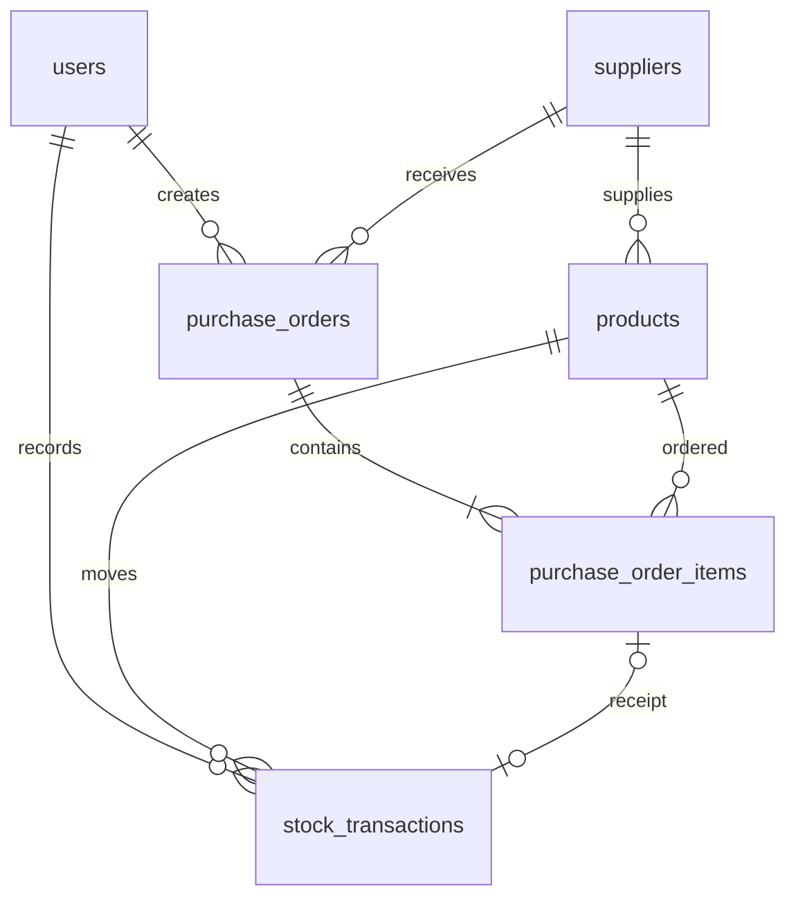

# StockPilot AI backend

One shared inventory workspace, one verified-user login and one dashboard. Every verified member can manage the same stock and supplier orders. Set TEAM_EMAILS to your teammates’ addresses to limit who can register for this shared workspace.

## First run in Eclipse (Windows)

1. Keep a backup of your current backend folder. Extract the archive into your stockpilot-ai folder. Confirm that backend/pom.xml and backend/src are siblings under backend. This project keeps the uploaded Spring Boot 4.2.0 and Java 25 settings. Select a full JDK 25 in Eclipse under Window → Preferences → Java → Installed JREs.
2. The existing stockpilot database is sufficient. Hibernate creates the six tables on first startup with a MySQL user that has schema and data privileges. The default URL is jdbc:mysql://localhost:3306/stockpilot.
3. File → Import → Maven → Existing Maven Projects → choose backend → Finish. Allow Maven to fetch dependencies. For an already imported project, Refresh and Maven → Update Project.
4. Run → Run Configurations → Java Application → select com.vcube.stockpilot.StockpilotApplication. Open Environment and add the variables below. Click Apply → Run. HTTP base URL is http://localhost:8080/api.
5. Use postman/StockPilot-Final.postman_collection.json to test and docs/frontend-api.md as the React contract. A browser visit to the protected dashboard requires the same bearer token.

| Environment variable | Value / use |
|---|---|
| DB_USERNAME, DB_PASSWORD | Your local MySQL credentials. Username defaults to root. |
| DB_URL | Optional JDBC URL if host, port or database differs. |
| JWT_SECRET | A private random value at least 32 bytes long. In PowerShell run the command below once, then paste its output into Eclipse. |
| SMTP_USERNAME | Sender mailbox or SMTP login. The **recipient** enters their own email in registration. |
| SMTP_PASSWORD | Sender provider's SMTP credential. For Gmail use an app password if your account supports app passwords. |
| SMTP_HOST, SMTP_PORT | Defaults to smtp.gmail.com and 587. Requires authenticated STARTTLS. |
| SMTP_FROM | Verified sender address if different from SMTP_USERNAME. |
| TEAM_EMAILS | Comma-separated permitted recipients, e.g. your four team addresses. Empty permits registration by anyone able to verify their email. |
| LLM_API_KEY, LLM_MODEL | API key and chat model from your provider. Default model is gpt-4o-mini. Choose a model enabled for your account. |
| LLM_URL | Full OpenAI-compatible chat completions endpoint. Default https://api.openai.com/v1/chat/completions. |
| FRONTEND_ORIGIN | Exact React origin, e.g. http://localhost:5173. Set to the live frontend origin when deployed. |
| PORT | Defaults to 8080. |

Generate a random JWT secret in Windows PowerShell:

```powershell
$bytes = New-Object byte[] 32
$rng = [System.Security.Cryptography.RandomNumberGenerator]::Create()
$rng.GetBytes($bytes)
[Convert]::ToBase64String($bytes)
$rng.Dispose()
```

Keep credentials in Eclipse's local environment or the deployment service. Postman requires the recipient's email, chosen StockPilot password and inbox OTP only.

# Start here

1. Eclipse: select JDK 25, import backend/pom.xml as a Maven project. Use your existing stockpilot MySQL database. Keep your existing Run Configuration with DB_PASSWORD and JWT_SECRET (32+ random bytes). DB_USERNAME defaults to root. Set SMTP_USERNAME and SMTP_PASSWORD for your sender; Gmail defaults to authenticated STARTTLS on port 587. Set LLM_API_KEY and LLM_MODEL for live AI. Run StockpilotApplication and wait for Started.
2. Postman → Import → StockPilot-Final.postman_collection.json. Open the newly imported StockPilot Final - Local API collection. The collection uses its own values; selecting an environment is optional.
3. Collection → Variables → local value of email: enter your real OTP inbox. Keep the supplied demo password for a new account. For an existing verified account enter its registered password and start at 03. Save. Base URL defaults to http://localhost:8080/api.
4. Send 01 Register once. Account is activated immediately (OTP removed). Send 03 Login (or optional 02 Verify). The collection automatically saves the bearer token. Send 04 Create supplier. Expect HTTP 200 with an id. 05 lists suppliers.
5. Send 06–23 in order for the inventory demo. The demo sells 2 units from 6 at 100 each, opens an 8-unit PO, then receives it. Final balance 12, revenue contribution 200. Create a fresh product when repeating; sending a new sale is a new transaction. 24 requires an active LLM provider. 25–29 are optional negative and resend checks; 26 is for an unverified signup and 29 is for a pending signup after 60 seconds.
6. A 400 response shows input field errors. For 401 repeat login with the verified account. For 503 at registration check backend SMTP settings. For 409 on registration the account may already be verified; try login. If TEAM_EMAILS is set, add the recipient email there before signup. Never export populated local credentials or tokens for sharing.

## Application rules

- Quantities and prices are validated. A new product starts at zero. Stock changes and transaction records are saved in one transaction with a product lock. Damage reduces stock and is excluded from revenue.
- Purchase orders support multiple distinct products from one supplier. Full receipt posts one IN/PURCHASE movement per line. This is an internal purchasing workflow with manual confirmation and receiving.
- Reorder target = ceil(daily sales × supplier lead days) + minStock. Suggested quantity = max(0, target − on-hand − open units due between today and the end of lead time). Risk compares current cover against lead time before receipts. Supplier promises and projected demand are estimates.
- Demand history covers at most seven dates including the current partial day, starting at product creation. The API returns observedDays so the UI can mark short histories as provisional. Zero observed sales gives zero baseline demand and undefined days of cover. Report dates use the backend machine’s time zone; for India set JVM argument -Duser.timezone=Asia/Kolkata.
- Analytics routes natural-language questions to a limited set of application reports and supplies only the relevant inventory data to the configured LLM. Supported periods are listed in the frontend contract. Providers receive business data for these features.
- OTP is emailed through SMTP, stored as a hash and never included in API responses. It expires after 10 minutes. There are five attempts per code and a 60-second resend cooldown. Login returns a bearer JWT valid for one hour.
- A mailbox delivery failure returns 503 and rolls back registration changes. For 401 check the bearer token, for 403 at login verify the email. For database startup errors check credentials, database name and MySQL service. For missing compiler/release 25 errors configure JDK 25 for both Eclipse and Maven.

## ER diagram



## Build and integration test

With JDK 25 and Maven installed, run from backend:

```shell
mvn clean test
mvn package
```

The included InventoryFlowTest uses H2 in MySQL mode and a mocked mail sender. It checks registration, verification, authenticated requests, order receipt, stock errors and dashboard revenue. The Postman walkthrough exercises the configured MySQL, SMTP and LLM services.

## Render backend

Use backend as the service root and Docker as runtime. Set DB_URL to the cloud MySQL JDBC URL, set DB credentials, SMTP, JWT, LLM and FRONTEND_ORIGIN in service environment settings. Use an SMTP-capable hosting plan and a reachable mail provider. The app reads Render's PORT. In React set the API base URL to the service's HTTPS URL followed by /api.

## Eclipse package layout

Under com.vcube.stockpilot, model contains the six JPA entities, repository contains one Spring Data interface per entity, dto contains request and report records, controller contains the domain REST controllers, features contains InventoryAiController, service holds transactional business logic and provider integrations, and config contains security and API errors. StockpilotApplication stays at the package root for component scanning.
